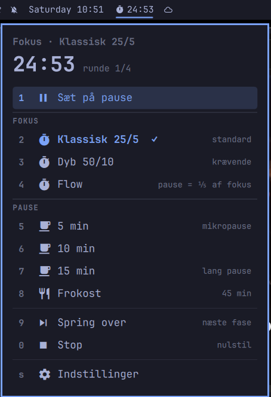

# Omarchy Pomodoro

A Pomodoro / focus timer for the [Omarchy](https://omarchy.org/) bar, with
breaks you can insert at any time and defaults chosen from the research on
work breaks.



> The interface is in Danish (Fokus = focus, Pause = break, Frokost = lunch).

## Install

```bash
omarchy plugin add https://github.com/rallevondalle/omarchy-pomodoro.git --enable --yes
omarchy bar move rallevondalle.pomodoro --after omarchy.clock
```

## Use

The bar shows `󱎫 24:13` while focusing, `󰅶 04:12` during a break, and a
dimmed icon when stopped.

| In the bar   | Action                                    |
| ------------ | ----------------------------------------- |
| Left click   | Start / pause / resume (flow: focus ⇄ break) |
| Right click  | Open the panel                            |
| Middle click | Skip to the next phase                    |
| Scroll       | ±1 minute on the running countdown        |

The panel drops down under the icon. Every action has a number key
(`1`–`9`, `0`), so `right click → 3` starts a deep-work session. Hovering or selecting a row shows a short explanation at the bottom of the panel. Arrows /
`j` `k` + Enter work too, `s` opens settings and Esc goes back or closes.

**Focus modes**

- **Klassisk 25/5**: 25 min focus, 5 min break, 15 min break after 4 rounds.
- **Dyb 50/10**: 50 min focus, 10 min break, 30 min break after 2 rounds.
- **Flow**: counts up. When your focus drops, click the timer to take the
  break, which is ⅕ of the focus time (2–30 min) and counts down. Click again
  to go back to focus. There's no pausing in flow, and a nudge after 90 min.

**Breaks** of 5, 10 or 15 min, or lunch (45 min by default), can be started
at any time. A break inserted mid-focus doesn't count that round towards
the long break.

**Break screen** (deep mode by default, or all breaks): running breaks take over every monitor with a big
countdown, the kind of break and a suggestion for what to do. The background
fades from the theme colour to black over the first minute. It grabs the
keyboard; `L` locks the session if you leave the desk, and holding `Esc` for
two seconds skips the break. When the break runs out the screen stays up and
counts the overtime, so a longer break than planned is still a break: `Enter`
or `Space` starts the next focus, `Esc` closes the screen and leaves the timer
waiting in the bar. It's a
separate overlay rather than the lock screen, because a session lock hides
every other surface and blanks the display, so it can't show a countdown.

**Settings** (`s` in the panel): lunch length, when to show the break screen (deep only / all breaks / off), and
which actions to show in the menu. Hidden actions are dropped and the rest are renumbered.

The classic mode's lengths can also be set in `shell.json`:

```bash
omarchy bar set rallevondalle.pomodoro workMinutes 30 --json
# also: shortBreakMinutes, longBreakMinutes, roundsPerLongBreak
```

From a terminal or keybinding:

```bash
omarchy-shell shell toggle rallevondalle.pomodoro      # open/close the panel (bind it, e.g. SUPER+CTRL+U)
omarchy-shell rallevondalle.pomodoro toggle            # start/pause
omarchy-shell rallevondalle.pomodoro focus deep        # classic | deep | flow
omarchy-shell rallevondalle.pomodoro takeBreak 10
omarchy-shell rallevondalle.pomodoro lunch
omarchy-shell rallevondalle.pomodoro cycleBreakScreen   # deep → all → off
omarchy-shell rallevondalle.pomodoro skip | stop | status
```

The timer works from deadlines and saves its state in
`~/.local/state/omarchy/rallevondalle-pomodoro.json`, so it survives shell restarts
and suspend. Time spent asleep counts as break time.

## Why it works like this

The research on breaks is small and not fully consistent. These are the
findings behind the choices, and how far they go:

| Finding | Design choice |
| --- | --- |
| Students with fixed breaks (24 min work / 6 min break) reported less fatigue and distraction and more concentration and motivation than students who chose their own breaks. Self-regulators worked and rested longer, with the same task completion. ([Biwer et al., 2023, *Br J Educ Psychol*](https://pubmed.ncbi.nlm.nih.gov/36859717/)) | Focus always rolls straight into a break. The timer, not willpower, decides when to stop. |
| A 2025 follow-up compared Pomodoro, Flowtime (self-chosen focus, break proportional to it) and self-regulated breaks. No differences in productivity, task completion or flow; differences in fatigue and motivation over time didn't add up to overall differences. ([PMC12292963](https://pmc.ncbi.nlm.nih.gov/articles/PMC12292963/)) | Flow mode with a ⅕ break, for work where a fixed bell breaks your flow. Fixed rhythms stay the default. |
| Micro-breaks (≤10 min) give a small boost in vigor and drop in fatigue. There's no clear overall performance effect, but longer breaks helped performance more, and the authors note that demanding tasks may need breaks over 10 min. ([Albulescu et al., 2022, *PLOS ONE*](https://doaj.org/article/c6f37b6ba159469296b2cb968b65505f)) | A deep mode with 10/30 min breaks, regular long breaks, and 15 min and lunch breaks available at any time. |
| Employees who used their phone on their lunch break reported more emotional exhaustion later in the day than those who didn't, and got no mood boost from the break. ([Rhee & Kim, via APS](https://www.psychologicalscience.org/news/minds-business/why-you-should-break-up-with-your-smartphone-during-lunch-breaks.html)) | Break notifications suggest moving, looking into the distance, water or talking to someone, and leaving the phone alone. |

Choices that rest on convenience rather than evidence:

- A finished break waits for a click instead of starting the next focus,
  because a countdown running while you're away from the desk is useless.
- The 90-minute nudge in flow mode is a soft reminder, not a
  research-backed number.
- Lunch defaults to 45 minutes.
- The break screen follows from the self-regulation finding above: in deep
  work it's tempting to "just finish this", so the break is made hard to
  skip rather than easy to ignore.

## Development

Work in a checkout and run `./install.sh`. It copies the plugin into
`~/.config/omarchy/plugins/rallevondalle.pomodoro`, enables it, places it
after the clock and restarts the shell. A restart is needed because
hot-reload keeps the service's IPC and the panel on the old code.

## License

MIT
